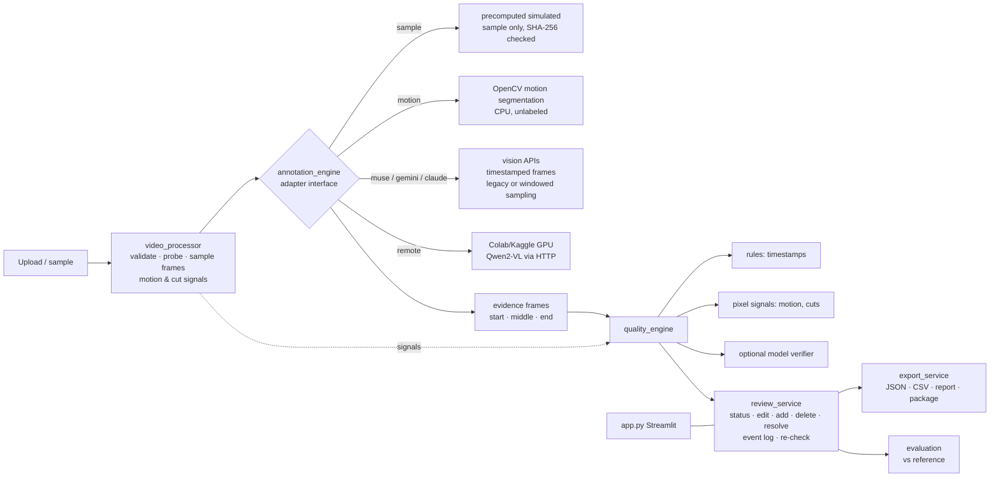

# Architecture

| Module | Responsibility | Depends on models? |
|---|---|---|
| `robotrace/schemas.py` | Pydantic data model: `Annotation`, `Flag`, `ReviewSession`, … | no |
| `robotrace/video_processor.py` | validation, probing, hashing, frame extraction, motion/cut signals, H.264 transcode | no |
| `robotrace/annotation_engine.py` | `AnnotationAdapter` protocol + 6 adapters (`sample`, `motion`, `claude`, `gemini`, `muse`, `remote`), timestamp grounding, evidence attachment | adapter-dependent |
| `robotrace/sampling.py` | legacy / windowed frame-sampling plans, cross-window merging | no |
| `robotrace/quality_engine.py` | three QC layers, resolution carry-over, priority ranking | layer 3 only |
| `robotrace/review_service.py` | every reviewer mutation, validated and logged; summary metrics | no |
| `robotrace/export_service.py` | versioned exports | no |
| `robotrace/evaluation.py` | IoU matching, boundary error, P/R, flag P/R | no |
| `robotrace/pipeline.py` | orchestration video → session (used by UI and tests) | — |
| `app.py` | Streamlit UI only | — |
| `remote_inference/server.py` | FastAPI GPU service for notebooks | yes |

## Key design decisions

- **Adapters, not a hard-wired model.** The UI only sees `AnnotationResult`. Adding a model means adding a
  class with `availability()` and `annotate()`.
- **Live vs precomputed is explicit.** `ProcessingInfo.is_live_inference` / `is_precomputed_sample` drive the
  badges in the UI and exports. The sample adapter refuses any video whose SHA-256 differs from the sample.
- **QC layers are separated and tagged.** Every flag carries `origin`. Rules are arithmetic, signals are pixel
  statistics, and model judgments are opinions. They are never blended into one opaque score.
- **No silent correction.** QC never edits timestamps. It flags candidates, and only the reviewer changes data.
- **Baseline is immutable.** `ReviewSession.baseline` and `initial_flags` are frozen for before/after views
  and evaluation; `annotations` and `flags` are the working state. Flags re-run after every edit, and
  resolutions carry over by a stable key.
- **State is per browser session** (Streamlit `session_state`). There is no database. The review package export
  is the durable artefact.

## Why these models

| Option | Used for | Why / limits |
|---|---|---|
| Claude (`claude-opus-5-5`, vision) | live annotation + verifier | No GPU needed on the free host; strong image understanding; works from a public URL with a key. Sees still frames only, so boundaries are quantised to the sampling interval (~1 s). Paid API (cost per video depends on frame count). |
| Qwen2-VL-2B-Instruct | remote GPU path | Apache-2.0, fits a free T4. Smaller model, so expect weaker labels; returned as-is so QC can flag its mistakes. |
| OpenCV motion segmentation | always-on fallback | Deterministic, free, fast. Gives timing only, with no semantics. |
| Image-captioning models | not used | Cannot infer action sequences from single images reliably. |
